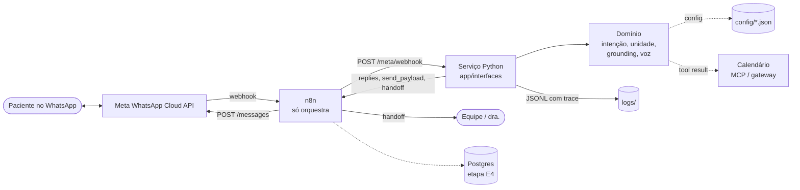
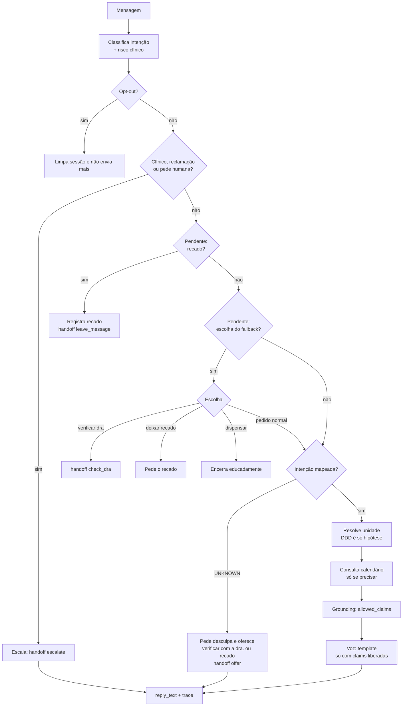
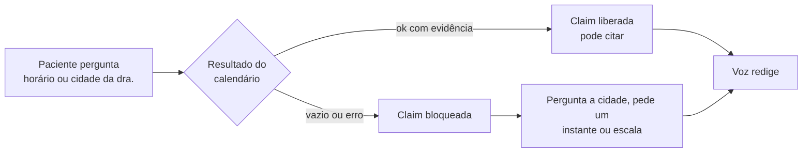
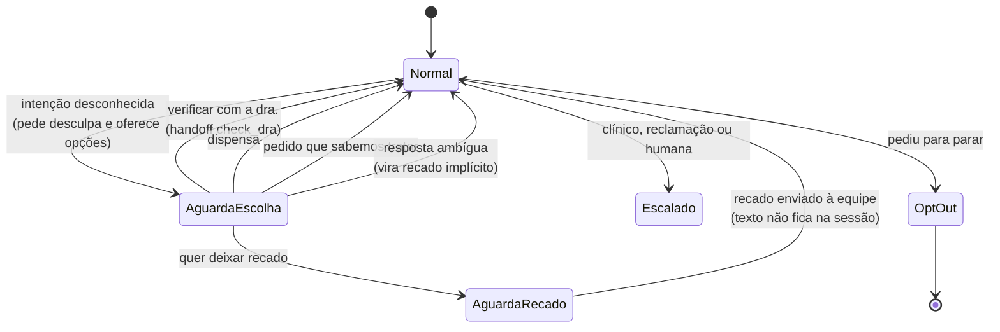

# Arquitetura — Secretária agentic no WhatsApp

Produto: secretária digital humanizada do consultório de **harmonização orofacial** (não odontologia geral). Orquestração no n8n; regras e grounding em Python; fatos de unidade, prática e agenda em config + MCPs.

## Decisão de fronteira

- **n8n** orquestra canais, retries e webhooks.
- **Domínio Python** classifica intenção, resolve unidade, aplica grounding.
- **MCPs** são a única forma de o time agentic (TPM / Dev / QA) e o runtime lerem fatos: clínicas, calendário, WhatsApp, guardrails.
- **LLM** só redige depois do grounding. Sem tool result, não afirma.

## Runtime (agentes de atendimento)

```text
WhatsApp ──► n8n Orchestrator
                 │
                 ├─► IntentClassifier
                 ├─► Location (DDD 46/16 + texto)
                 ├─► Presence (calendário / viagem)
                 ├─► Agenda (Google Calendar freebusy / events)
                 ├─► GuardrailGrounding
                 ├─► SecretaryVoice
                 └─► Escalation ──► humana
```

| Agente | Pode | Não pode |
|---|---|---|
| Orchestrator | Encadear passos, persistir estado da conversa | Inventar regras de negócio |
| IntentClassifier | CONFIRM, RESCHEDULE, CANCEL, QUESTION, AVAILABILITY, LOCATION, UNKNOWN | Confirmar consulta sozinho |
| Location | Mapear DDD/texto → unidade hipotética | Dizer onde a dra está |
| Presence | Ler calendário/blocos de deslocamento | Inferir cidade pelo DDD do paciente |
| Agenda | Consultar e, após confirmação, mutar eventos | Oferecer horário sem freebusy |
| GuardrailGrounding | Cortar claims sem evidência | Deixar o LLM “completar” |
| SecretaryVoice | Redigir tom humano | Introduzir fatos novos |
| Escalation | Passar para humana com contexto | Continuar chutando |

## Diagramas (Mermaid)

### Contexto: quem fala com quem



### Um turno: ordem de decisão (`process_turn`)



### Grounding: ferramenta vazia ou com erro



### Fallback fora do mapeado (estados da sessão)



## Unidades

- Pato Branco — DDD 46 — calendário próprio (`config/clinic.json`)
- São Carlos — DDD 16 — calendário próprio
- Número 55 + DDD é **hipótese de paciente**, não presença da dra

## Camadas de código

- `app/domains/` — intenção, unidade, grounding
- `app/infrastructure/` — loaders e clientes MCP
- `app/interfaces/http/` — contrato para o n8n
- `app/interfaces/meta/` — adaptador da WhatsApp Cloud API (Meta): parse do webhook, assinatura, dedup, `send_payload`
- `app/infrastructure/observability/` — log por turno (terminal + JSONL) com `trace`
- `config/` — guardrails e clínicas (sem hardcode)
- `mcp/schemas/` — contratos para Cursor e runtime
- `workflows/` — n8n, sem regras de unidade/agenda

## Fluxo de uma mensagem

1. Webhook WhatsApp → n8n
2. Classificar intenção
3. Resolver unidade (mensagem + DDD)
4. Se precisar de “onde está a dra” ou “tem horário”, chamar MCP de calendário
5. Grounding: lista de claims permitidos
6. Voz humanizada só com claims permitidos
7. Se confiança baixa, ferramenta falhou ou pedido clínico → escalar

## Canal: WhatsApp Cloud API (Meta)

```
Meta ──webhook──► n8n (Webhook, Raw Body) ──► POST /meta/webhook (Python)
                                                  │  valida X-Hub-Signature-256, deduplica wamid,
                                                  │  roda process_turn por mensagem
n8n ◄── replies[].send_payload ◄──────────────────┘
n8n ──► POST graph.facebook.com/v{ver}/{phone_number_id}/messages (Bearer META_ACCESS_TOKEN)
```

- `GET /meta/webhook` responde o desafio de verificação (`META_VERIFY_TOKEN`).
- n8n só orquestra e envia; a decisão fica no serviço Python. `handoff` diz à equipe o que fazer (`offer`, `check_dra`, `leave_message`, `escalate`).
- Fora do mapeado: a secretária pede desculpa e oferece verificar se a dra. atende pelo WhatsApp ou guardar o recado (sem prometer horário de retorno).
- Fora da janela de 24h a Meta exige template aprovado; não coberto no MVP.
- Estado de sessão, opt-out e dedup estão em memória até a etapa E4 (banco).

## Segurança

- Sem diagnóstico, prescrição ou preço inventado
- Opt-out imediato
- Logs de decisão (intent, evidências, claims, escalonamento)
- Segredos só em `.env`, nunca no git

Detalhe de problemas: `docs/canonical/CANONICAL_MAP.md`.
Fases: `IMPLEMENTATION_PLAN.md`.
Agentes de entrega: `AGENTS.md`.
